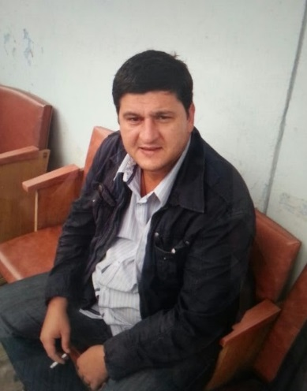
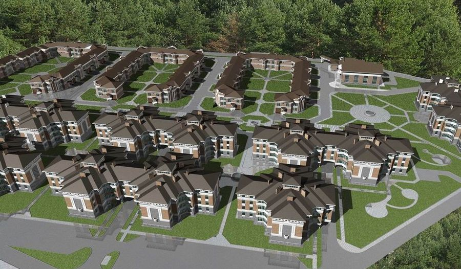
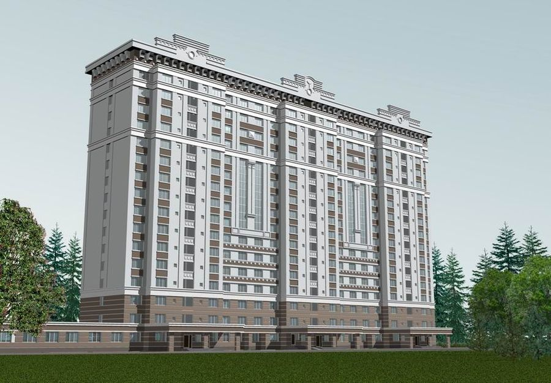
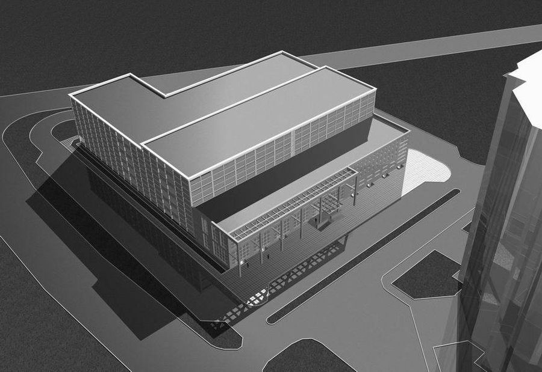
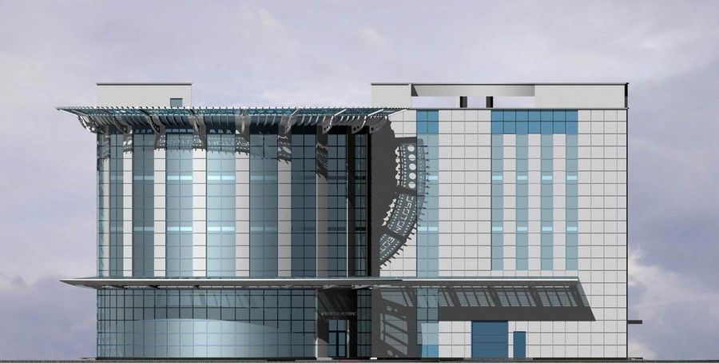

Золотов Алексей Станиславович

27.06.1971

Образование

<table>
<colgroup>
<col style="width: 8%" />
<col style="width: 62%" />
<col style="width: 28%" />
</colgroup>
<thead>
<tr>
<th>2015</th>
<th>
Межотраслевой институт работников сфер госзакупок инвестиционной и градостроительной деятельности

Градостроительная деятельность (диплом, доп. в/о)
</th>
<th rowspan="2" style="text-align: center;"></th>
</tr>
<tr>
<th>1999</th>
<th>
Таджикский Политехнический Институт

Архитектура (диплом)
</th>
</tr>
</thead>
<tbody>
</tbody>
</table>

2018-настоящее время

**ООО «Центрпроект» -главный инженер проекта.**

**Проектирование полный цикл (в основном многоквартирное жилье г. Москва)**

2016- 2018

**Федеральное Государственное унитарное предприятие**

**"Главное военно-строительное управление № 1" ФГУП «ГВСУ №1»**

**Начальник отдела строительного проектирования**

2012-2016 (4 года 6 месяцев)

**«26 Центральный научный институт» — филиал АО «31 ГПИСС» МО РФ**

**Начальник группы проектирования специальных объектов.**

Строительство, Архитектура, конструктив.

2006 — 2012 (6 лет 7 месяцев)

**Архитектурно конструкторское бюро "Балашихагорпроект"** (Балашиха, [<u>balaig.ru</u>](http://balaig.ru/)) — Строительство, недвижимость, архитектура

**Генеральный директор, Главный архитектор проектов**

Проектирование, согласование, экспертиза, сопровождение, консультации:  
полный цикл проектной и предпроектной документации.

2005 —2011 (6 лет 1 месяц)

**МУП "Архитектура и градостроительство"** (Балашиха) — Строительство, недвижимость, архитектура

**Главный архитектор проектов**

Проектные работы, ГИС (геоинформационные системы)

2003 —2005 (2 год 1 месяц)

**Строительный холдинг** (Москва) — Строительство, недвижимость, архитектура

**ведущий архитектор, главный архитектор проектов**

Проектные работы

2000 —2003 (3 года 1 месяц)

**МУП "Архград"** ( Оренбург) — Строительство, недвижимость, архитектура

**ведущий архитектор**

**  **

**Основные работы:**

**Микрорайон «Салтыковка-Престиж» <https://maps.yandex.ru/-/CVGLmTYz>**

**Концепция, проект(«П»), согласования, экспертиза.**

**Детский сад [https://maps.yandex.ru/-/CVGLm-n-#](https://maps.yandex.ru/-/CVGLm-n-)**

**Проект («П», «Р»), согласования, экспертиза.**

**Ледовый дворец Балашиха-арена <https://maps.yandex.ru/-/CVGLqALu>**

**Генеральный план, благоустройство («П»).**

**Жилой многоквартирный дом <https://maps.yandex.ru/-/CVGLqI5B>**

**Концепция, проект («П», «Р»), согласования, экспертиза.**

**Общежитие МВД <https://maps.yandex.ru/-/CVGLqQn4>**

**Концепция, проект («П»).**

**Автотехцентр с паркингом** <https://maps.yandex.ru/-/CVGLqR~y>

**Концепция, проект («П», «Р»), согласования, экспертиза.**

**Автотехцентр с цехом кузовного ремонта Реутов-Моторс.**

**Концепция, проект («П»), согласования, экспертиза.**

Торговые центры:

<https://maps.yandex.ru/-/CVGLqY~p>

<https://maps.yandex.ru/-/CVGLq4P6>

<https://maps.yandex.ru/-/CVGLqK-A>

**Объекты Минобороны: военные городки, парки техники, хранилища, спецфортсооружения**
