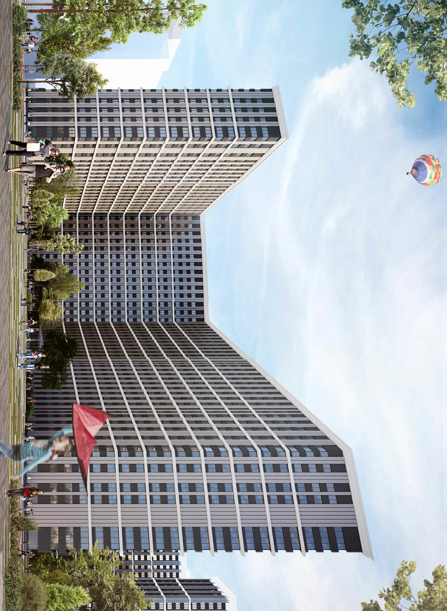
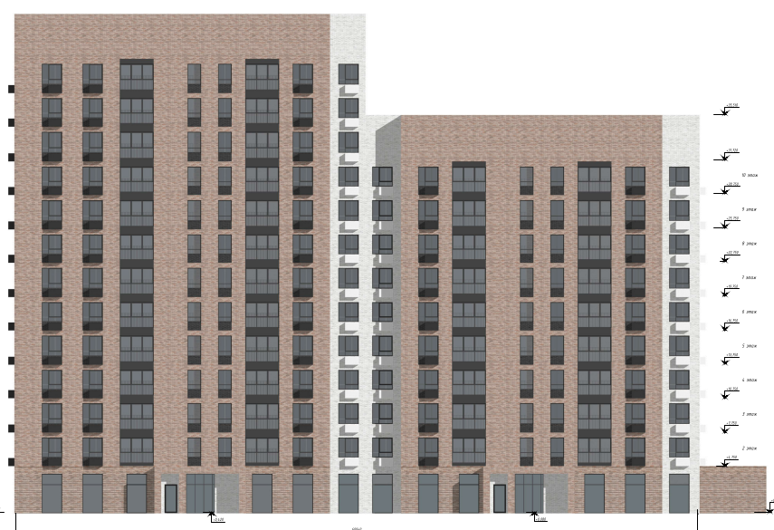
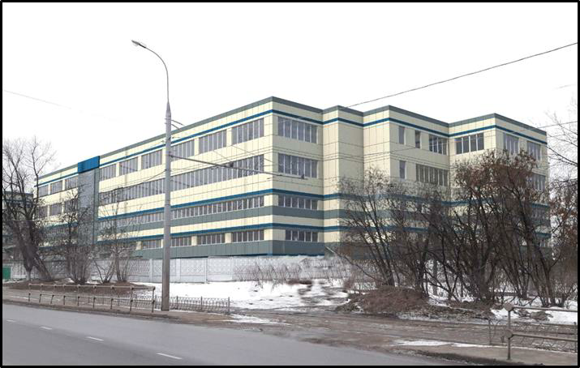
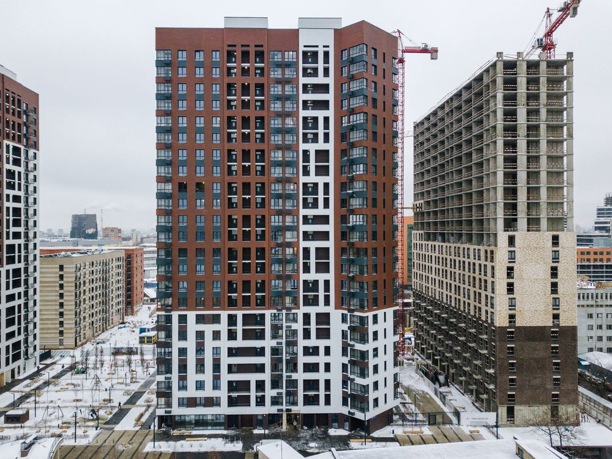
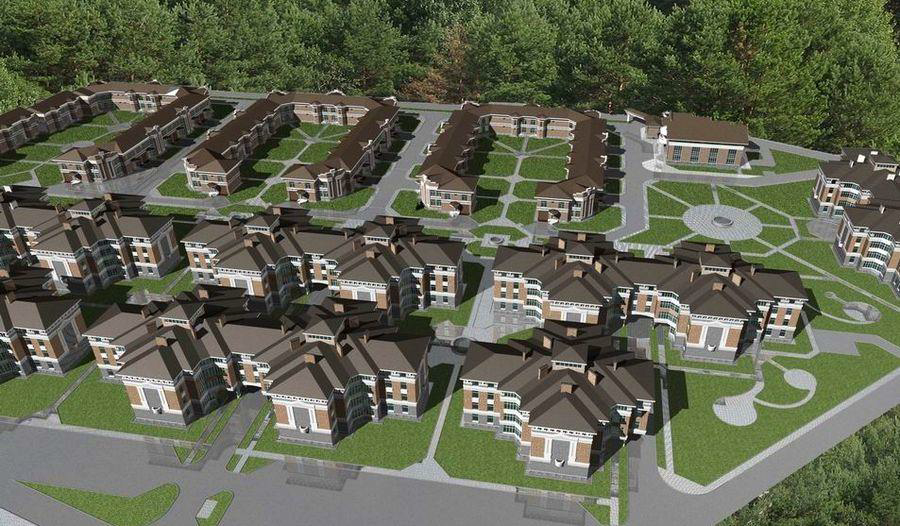
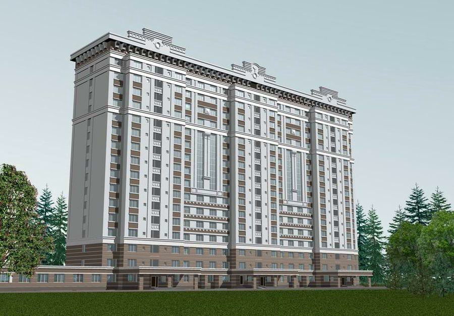
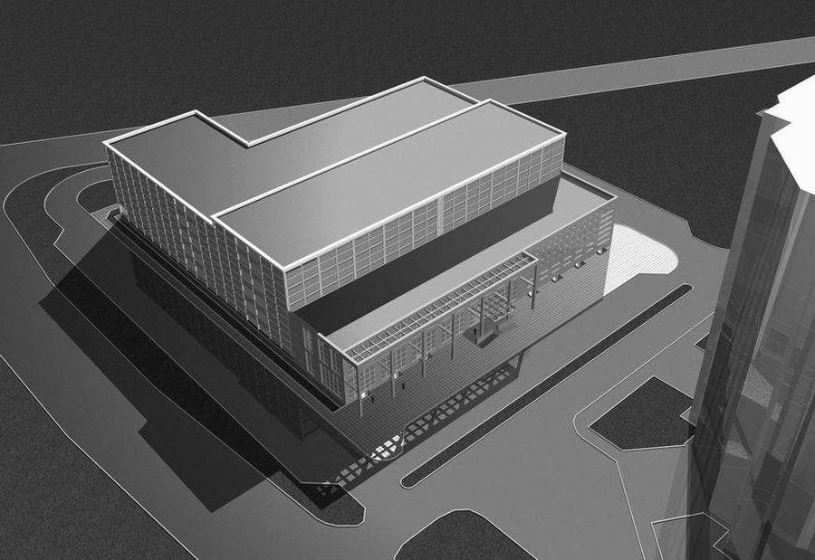

> Золотов Алексей Станиславович
>
> 27.06.1971
>
> Образование
>
> *1*

(ГИП, ГАП, Начальник отдела проектирования)

> 2015
>
> 1999

Межотраслевой институт работников сфер госзакупок инвестиционной и градостроительной деятельности Градостроительная деятельность (диплом, доп. в/о)

Таджикский Политехнический Институт Архитектура (диплом)

> 2018-настоящее время
>
> **ООО «Центрпроект» -Главный инженер проекта (Комплексный ГИП)** Проектирование полный цикл, экспертиза, согласования (в основном многоквартирное жилье г. Москва)
>
> 2016- 2018
>
> **Федеральное Государственное унитарное предприятие**
>
> **"Главное военно-строительное управление № 1" ФГУП «ГВСУ №1»**  
> **Начальник отдела строительного проектирования**
>
> 2012-2016 (5 лет)
>
> **«26 Центральный научный институт» — филиал АО «31 ГПИСС» МО РФ**
>
> **Начальник группы проектирования специальных объектов.**
>
> Архитектура, конструктив, авторский надзор.
>
> 2006 — 2012 (5 лет 7 месяцев)
>
> **Архитектурно конструкторское бюро "Балашихагорпроект"** (Балашиха[, <u>balaig.ru</u>](http://balaig.ru/)) — Строительство, недвижимость, архитектура
>
> **Генеральный директор, Главный архитектор проектов**
>
> Проектирование, согласование, экспертиза, сопровождение, консультации:
>
> полный цикл проектной и предпроектной документации.
>
> 2005 —2011 (6 лет 1 месяц)
>
> **МУП "Архитектура и градостроительство"** (Балашиха) — Строительство, недвижимость, архитектура
>
> **Главный архитектор проектов**
>
> Проектные работы, ГИС (геоинформационные системы)
>
> 2003 —2005 (2 год 1 месяц)
>
> **Строительный холдинг** (Москва) — Строительство, недвижимость, архитектура **ведущий архитектор, главный архитектор проектов**
>
> Проектные работы
>
> 2000 —2003 (3 года 1 месяц)
>
> **МУП "Архград"** ( Оренбург) — Строительство, недвижимость, архитектура  
> **ведущий архитектор**

> **Многоквартирный жилой комплекс с нежилыми помещениями на первых этажах, детской** **дошкольной образовательной организацией на 100 мест и подземным гаражом**
>
> по адресу: г. Москва, ул. Берзарина вл. 30. - Проект "П", согласование, экспертиза.

> **Реконструкция производственного комплекса с административно-бытовыми помещениями,** **расположенного по адресу: Московская область, г. Звенигород, микрорайон «Ракитня»**
>
> \- Проект "П", согласование, экспертиза.

> **Жилой дом с инженерными сетями и благоустройством территории по адресу: г. Москва, внутриго-** **родское муниципальное образование Кузьминки, Волгоградский пр-кт, влд.163**- Рабочая документация

> **Комплекс жилых зданий, включая встроенно-пристроенные нежилые помещения, с объекта** **ми социального назначения и офисным зданием; месторасположение: г. Москва, САО, ул.** **Викторенко, вл.11-** Рабочая документация

> **Реконструкция производственно-складского здания по адресу: г. Москва, ул.** **Угрешская, д. 27, стр. 1-** Проект, Рабочая документация

> **ЖК Петр I по адресу: г. Москва, ул. Красноказарменная д. 14А-** Проект, Рабочая документация
>
> *2*
>
> **Микрорайон «Салтыковка-Престиж» [<u>https://maps.yandex.ru/-/CVGLmTYz</u>](https://maps.yandex.ru/-/CVGLmTYz)** **Концепция, проект(«П»), согласования, экспертиза.**

> **Детский сад** [**<u>https://maps.yandex.ru/-/CVGLm-n-#</u>**](https://maps.yandex.ru/-/CVGLm-n-) **Проект («П», «Р»), согласования, экспертиза.**
>
> **Ледовый дворец Балашиха-арена** [**<u>https://maps.yandex.ru/-/CVGLqALu</u>**](https://maps.yandex.ru/-/CVGLqALu) **Генеральный план, благоустройство («П»).**
>
> **Жилой многоквартирный дом [<u>https://maps.yandex.ru/-/CVGLqI5B</u>](https://maps.yandex.ru/-/CVGLqI5B)** **Концепция, проект («П», «Р»), согласования, экспертиза.**
>
> **Общежитие МВД [<u>https://maps.yandex.ru/-/CVGLqQn4</u>](https://maps.yandex.ru/-/CVGLqQn4)** **Концепция, проект («П»), экспертиза.**
>
> *3*
>
> **Автотехцентр с паркингом** [<u>https://maps.yandex.ru/-/CVGLqR~y</u>](https://maps.yandex.ru/-/CVGLqR~y)
>
> **Концепция, проект («П», «Р»), согласования, экспертиза.**

> **Автотехцентр с цехом кузовного ремонта Реутов-Моторс.**
>
> **Концепция, проект («П»), согласования, экспертиза.**

> Торговые центры:
>
> [<u>https://maps.yandex.ru/-/CVGLqY~p</u>](https://maps.yandex.ru/-/CVGLqY~p)
>
> [<u>https://maps.yandex.ru/-/CVGLq4P6</u>](https://maps.yandex.ru/-/CVGLq4P6)
>
> [<u>https://maps.yandex.ru/-/CVGLqK-A</u>](https://maps.yandex.ru/-/CVGLqK-A)
>
> **Объекты Минобороны:**
>
> **военные городки, парки техники, хранилища, спецфортсооружения**
