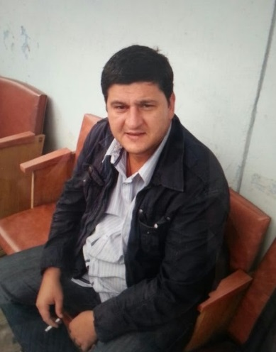
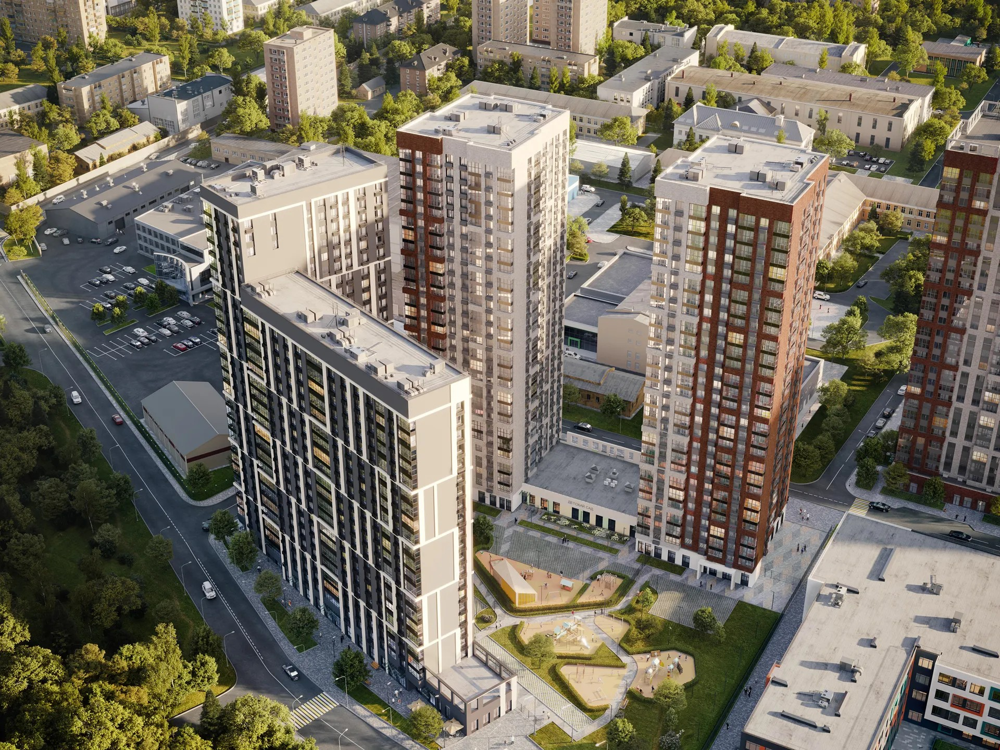
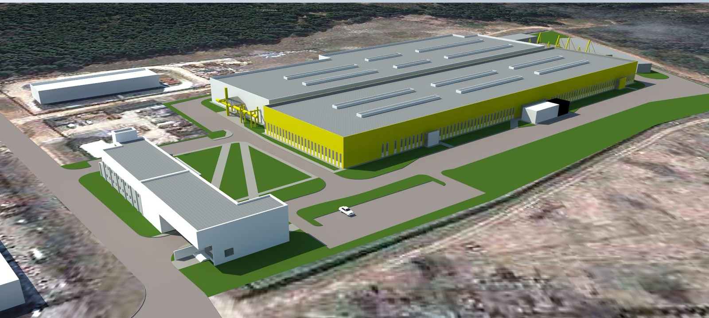
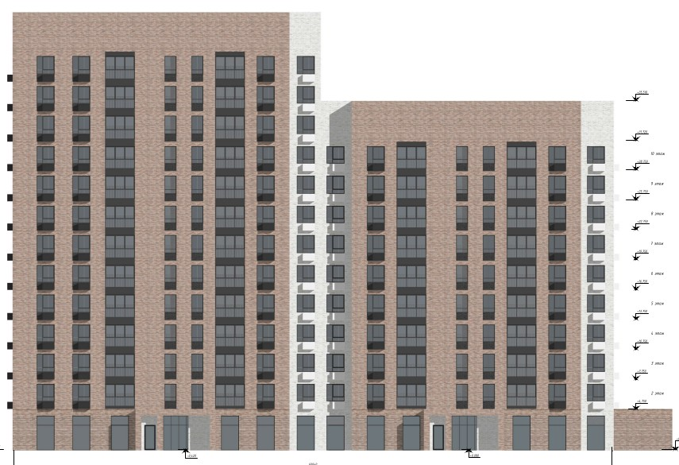
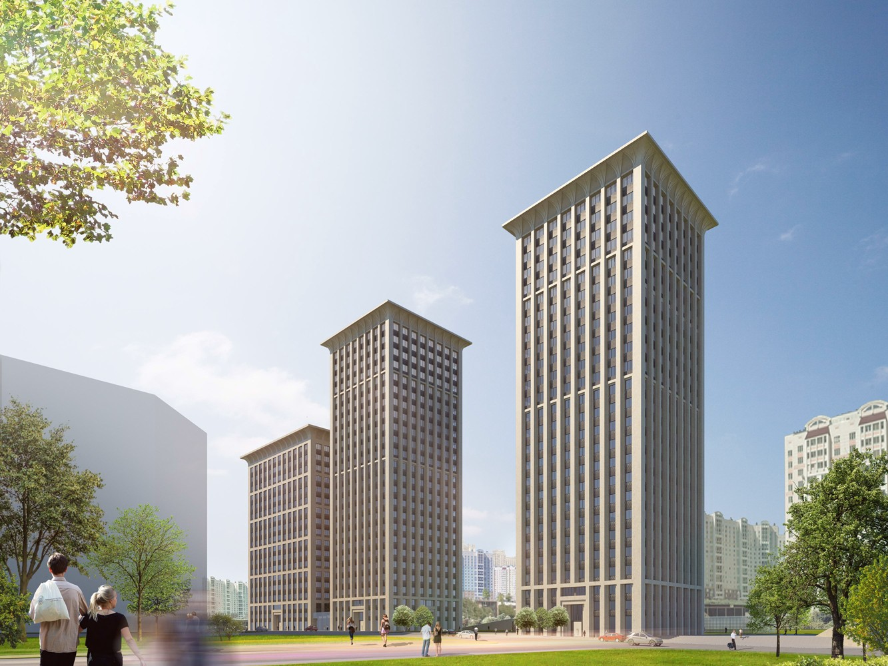
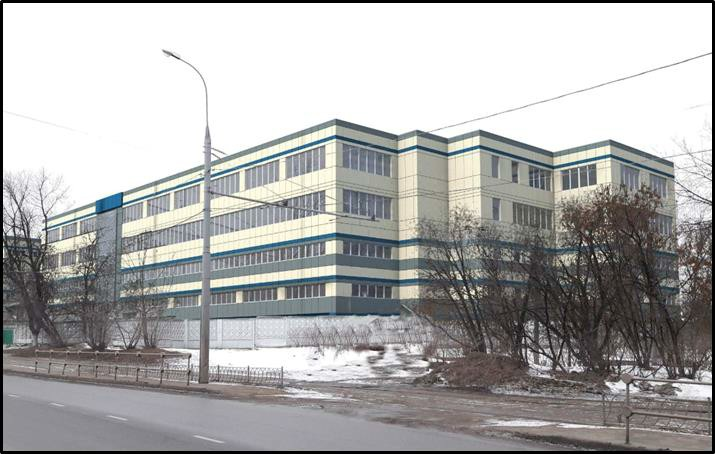
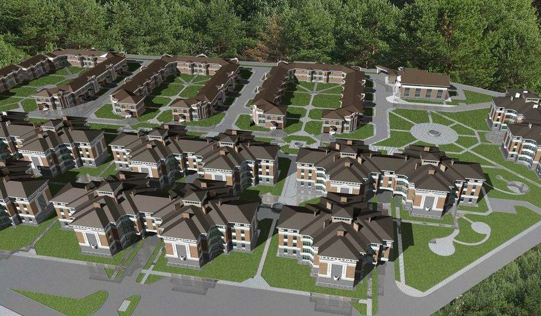
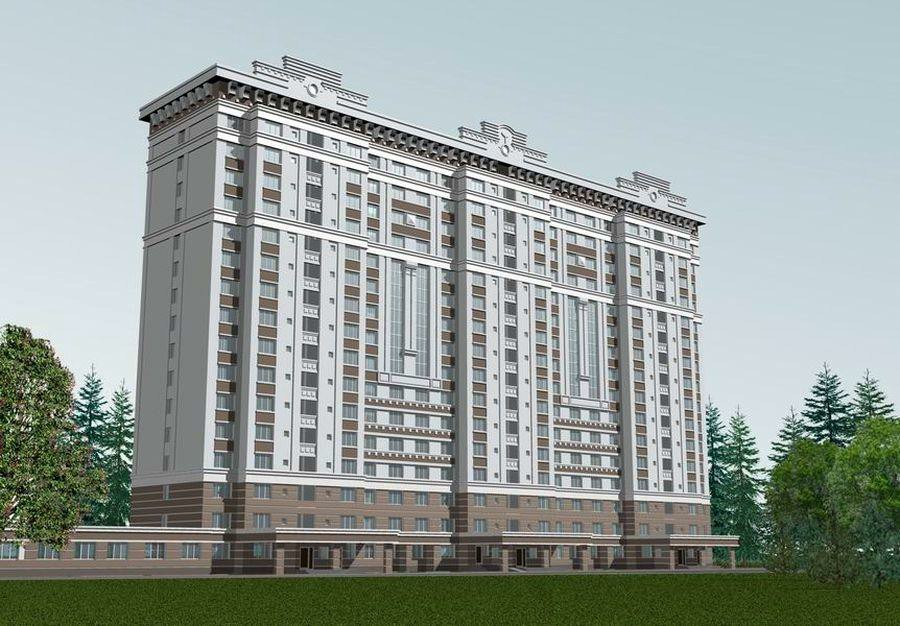
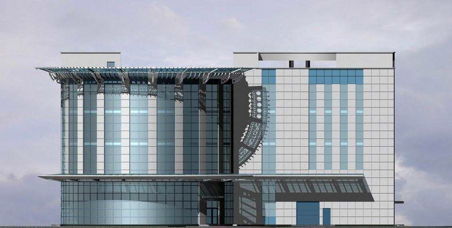

# Золотов Алексей Станиславович
**Главный инженер проекта (ГИП) / Главный архитектор проектов (ГАП) / Руководитель отдела проектирования**

<table style="border-collapse: collapse; border: none; width: 100%; margin-bottom: 20px;">
  <tr>
    <td width="150" valign="top" style="border: none; padding-right: 20px;">
      
    </td>
    <td valign="middle" style="border: none;">
      <ul style="list-style-type: none; padding-left: 0; margin-top: 0;">
        <li>📍 Москва / Московская область</li>
        <li>📞 <a href="tel:+70000000000">[Ваш телефон]</a></li>
        <li>✉️ <a href="mailto:email@example.com">[Ваш Email]</a></li>
        <li>💻 <a href="https://github.com/alexnaos">github.com/alexnaos</a></li>
      </ul>
    </td>
  </tr>
</table>

---

### О СЕБЕ
Опытный руководитель проектов и комплексный ГИП с более чем 20-летним стажем в строительстве, архитектуре и управлении проектированием. Специализируюсь на полном жизненном цикле объектов (от концепции и стадии «П» до выпуска «РД» и защиты в Мосгосэкспертизе). Имею успешный опыт руководства проектированием уникальных спецобъектов Минобороны РФ и масштабных многоквартирных жилых комплексов Москвы. 

**Отличительная особенность:** сочетаю классическую инженерную экспертизу с глубоким интересом к IT-технологиям. Владею Python, автоматизирую рутинные процессы, интегрирую BIM-решения и использую современные нейросети (ИИ) для повышения эффективности проектных команд.

---

### КЛЮЧЕВЫЕ КОМПЕТЕНЦИИ
*   **Управление:** Руководство проектной командой (до 50+ человек), составление бюджетов, графиков, тендеры, договорная работа с подрядчиками и субподрядчиками.
*   **Согласования:** Полное сопровождение проектов в надзорных органах (Мосгосэкспертиза, Мосводосток, Ростелеком, МОЭСК и др.), получение ТУ.
*   **Технический аудит:** Проверка и оптимизация разделов СПОЗУ, ТХ, АР, ПОС, инженерных систем. Поиск несоответствий и нарушений нормативов.
*   **Технологии:** Профессиональное владение CAD-системами (ПРОСАПР, СПДС, AutoCAD, Revit), ГИС-системами. Программирование (Python, C++), IoT (ESP32).
*   **Soft skills:** Стратегическое планирование, стрессоустойчивость, ведение сложных переговоров с заказчиками и экспертизой, наставничество.

---

### ОПЫТ РАБОТЫ

**Главный инженер проекта** | *"ССК-проект"* 
*Фев 2021 — н.в.*
*   Вёл полный цикл проектной работы: выпускал проектную документацию по всем разделам.
*   Согласовывал проектные решения и сопровождал проект до реализации.
*   Самостоятельно координировал работу специалистов, распределял задачи между участниками и принимал ключевые решения.

**Главный инженер проекта (Комплексный ГИП)** | *ООО «Центрпроект»* 
*2018 — 2021* *
*   Управление проектами полного цикла (в основном многоквартирное жилье г. Москва).
*   Организация процесса проектирования, координация смежных разделов, контроль сроков и качества выпускаемой документации.
*   Успешное прохождение экспертиз и согласование проектных решений (стадии «П» и «РД»).

**Начальник отдела строительного проектирования** | *ФГУП «ГВСУ №1»* 
*2016 — 2018*
*   Руководство отделом строительного проектирования.
*   Курирование проектов специального назначения (объекты Минобороны РФ).
*   Внедрение стандартов качества и контроль выпуска проектной документации.

**Начальник группы проектирования специальных объектов** | *АО «31 ГПИСС» МО РФ (26 ЦНИИ)* 
*2012 — 2016*
*   Руководство группой проектировщиков (архитектура, конструктив).
*   Осуществление авторского надзора за строительством спецобъектов.

**Генеральный директор, Главный архитектор проектов** | *АКБ "Балашихагорпроект"* 
*2006 — 2012*
*   Полное управление архитектурно-конструкторским бюро: операционное руководство, найм, развитие бизнеса.
*   Разработка концепций, проектной и предпроектной документации.
*   Согласование проектов и сопровождение экспертиз.

**Главный архитектор проектов** | *МУП "Архитектура и градостроительство" (г. Балашиха)* 
*2005 — 2011*
*   Проектные работы. Разработка и внедрение ГИС (геоинформационных систем).

**Ведущий архитектор, Главный архитектор проектов** | *МУП "Архград" (г. Оренбург) и Строительный холдинг (г. Москва)* 
*2000 — 2005*
*   Разработка архитектурных решений, координация проектных работ.

---

### КЛЮЧЕВЫЕ ПРОЕКТЫ (Избранное)

#### Современные объекты (Москва и МО)

**Многоквартирный жилой комплекс с нежилыми помещениями на первых этажах, ДОО на 100 мест и подземным гаражом**
*г. Москва, ул. Берзарина, вл. 30. — Проект "П", согласование, экспертиза.*

  

 

**Реконструкция производственного комплекса с административно-бытовыми помещениями**
*Московская область, г. Звенигород, микрорайон «Ракитня» — Проект "П", согласование, экспертиза.*

  

 

**Жилой дом с инженерными сетями и благоустройством территории**
*г. Москва, внутригородское МО Кузьминки, Волгоградский пр-кт, влд.163 — Рабочая документация.*

  

 

**Комплекс жилых зданий с объектами социального назначения и офисным зданием**
*г. Москва, САО, ул. Викторенко, вл.11 — Рабочая документация.*

  

 

**Реконструкция производственно-складского здания**
*г. Москва, ул. Угрешская, д. 27, стр. 1 — Проект, Рабочая документация.*

  

 

**ЖК Петр I**
*г. Москва, ул. Красноказарменная д. 14А — Проект, Рабочая документация.*

  

 

---

#### Архитектурные концепции и коммерческие объекты

**Микрорайон «Салтыковка-Престиж»** 
*Концепция, проект(«П»), согласования, экспертиза.* [[Ссылка на карту](https://maps.yandex.ru/-/CVGLmTYz)]

  

 

**Детский сад** 
*Проект («П», «Р»), согласования, экспертиза.* [[Ссылка на карту](https://maps.yandex.ru/-/CVGLm-n-#)]
  

**Ледовый дворец Балашиха-арена** 
*Генеральный план, благоустройство («П»).* [[Ссылка на карту](https://maps.yandex.ru/-/CVGLqALu)]
  

**Жилой многоквартирный дом** 
*Концепция, проект («П», «Р»), согласования, экспертиза.* [[Ссылка на карту](https://maps.yandex.ru/-/CVGLqI5B)]
  

**Общежитие МВД** 
*Концепция, проект («П»), экспертиза.* [[Ссылка на карту](https://maps.yandex.ru/-/CVGLqQn4)]

  

 

**Автотехцентр с паркингом** 
*Концепция, проект («П», «Р»), согласования, экспертиза.* [[Ссылка на карту](https://maps.yandex.ru/-/CVGLqR~y)]

  

 

**Автотехцентр с цехом кузовного ремонта «Реутов-Моторс»** 
*Концепция, проект («П»), согласования, экспертиза.*

  

 

**Торговые центры** 
*Концепция, проект, согласование.* [[Карта 1](https://maps.yandex.ru/-/CVGLqY~p)] | [[Карта 2](https://maps.yandex.ru/-/CVGLq4P6)] | [[Карта 3](https://maps.yandex.ru/-/CVGLqK-A)]
  

**Объекты Минобороны:** военные городки, парки техники, хранилища, спецфортсооружения. *(Фото и локации закрыты)*
 

---

### ОБРАЗОВАНИЕ
*   **2015** — Межотраслевой институт работников сфер госзакупок инвестиционной и градостроительной деятельности. *Градостроительная деятельность (диплом, доп. в/о).*
*   **1999** — Таджикский Политехнический Институт. *Архитектура (диплом).*

---

### ДОПОЛНИТЕЛЬНО (Технические увлечения)
*   **Программирование и IoT:** Разработка умных устройств и систем автоматизации на базе микроконтроллеров ESP32 (C++), написание скриптов на Python. Интеграция устройств с Home Assistant и MQTT.
*   **Искусственный интеллект:** Активное применение LLM (DeepSeek, Gemini, ChatGPT) для написания кода, автоматизации документооборота, оптимизации поиска нормативной документации и решения инженерных задач.
*   **Личные интересы:** Рыбалка, научная фантастика , электронная музыка (Liquid dnb, Trance), схемотехника.